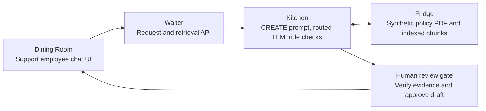

# RakuRaku Express AI Shipping Support Agent

**Fictional classroom prototype.** The working demo runs locally on the project computer; see [run instructions](demo/README.md). A video link will be added after recording.

## Business problem and quick win

Customer support teams spend time locating policy clauses, calculating business days, and drafting consistent answers. This Customer Service RAG assistant targets **cost reduction and risk mitigation**. It is a high impact, high feasibility Quick Win because a three-page synthetic policy supplies bounded rules, while a human retains every external decision. It does not decide claims autonomously.

## Knowledge base and working flow

The synthetic three-page *Customer Shipping Claims and Service Recovery Policy*, version 1.0, contains more than five nonstandard numeric rules: standard 2 business days, expedited 1, international 7 unless the order confirmation differs, written notice within 5, weather documentation within 3, frontline credit approval up to $500, and escalation of refund requests above $500 within 4 business hours. The local prototype ingests a case, retrieves relevant policy clauses, applies a rule gate, and uses a local Qwen3 4B Instruct model for complete routine drafts. Missing evidence and high risk cases bypass the model and receive a deterministic safe response. No private data leaves the computer.

The exact six-part CREATE prompt is [available here](RakuRaku_CREATE_system_prompt.md). It includes two few-shot examples, evidence checks, refusal to invent policy, and a human approval gate.

## Restaurant Analogy architecture

The Waiter transports a fictional question and retrieved passages. No webhook, MCP connection, ticket write, or outbound message is part of the classroom prototype. In production, any such connection would require separate scoped access and approval. The Fridge stores policy chunks and embeddings where the selected RAG platform supports them; verify the platform's actual implementation before naming a particular vector database.

## Demonstration and red team audit

Three ordinary cases and three adversarial cases are specified in the [test plan](RakuRaku_scenarios_and_test_plan.md). They were run locally and recorded in the [observed test report](RakuRaku_observed_test_report.md); screenshot files will be added to the final export. The attacks cover prompt injection, social pressure for an unauthorized refund, and impossible numerical inputs. The prompt and code gate require cited answers, incomplete evidence status, manager escalation, and no external action. The same local model was also tested without retrieval; its answer invented a Friday noon deadline absent from the synthetic policy. The grounded response cited the actual 2-business-day commitment and $80 maximum standard credit.

## Governance and security

In *Moffatt v. Air Canada* (2024 BCCRT 149), the British Columbia Civil Resolution Tribunal held Air Canada responsible for inaccurate fare guidance from its website chatbot. The lesson for this prototype is that an AI answer displayed to a customer can create liability; a disclaimer alone is insufficient. A support employee checks carrier scans, dates, invoice charge, citations, and exception proof before approving any response. The manager reviews requests above the $500 frontline limit and exceptions. The AI never sends a reply, grants a credit, or changes a ticket itself. Human review reduces risk but does not guarantee legal immunity. [Case discussion](https://www.canlii.org/en/bc/bccrt/doc/2024/2024bccrt149/2024bccrt149.html).

Production deployment would use a **closed tenant** enterprise license with contractual data controls, retention limits, and training restrictions. This addresses Shadow AI: employees should use the approved workspace rather than pasting case details into personal public tools. The 2023 Samsung incident illustrates the exposure created when employees enter confidential code into a public chatbot ([OECD incident record](https://oecd.ai/en/incidents/2023-04-06-93c9)). This classroom build uses only synthetic data.

The RAG service and any future ticket connector would each receive a distinct **Non Human Identity** with short lived credentials and least privilege. The retrieval identity could read the policy index but not customer tickets; the draft service could write to a review queue only; the action connector, if ever introduced, would require an approved human event. **Zero Trust microsegmentation** would restrict network paths among the UI, model gateway, vector store, and ticket system, with authentication and authorization at each hop ([NIST SP 1800-35](https://csrc.nist.gov/pubs/sp/1800/35/final)). Log citations, model route, reviewer, approval status, and actions without storing unnecessary personal data.

## Model routing and context controls

The proposed enterprise route uses a lower cost distilled or small model for routine intent classification, retrieval query rewriting, and straightforward cited drafts. Route complex exceptions, conflicting policy passages, legal risk indicators, and uncertain calculations to a frontier model **and** a human reviewer. This is a design plan, not a claim about Meta Muse's selectable models. Bound retrieved context to the top three policy chunks (about 1,500 tokens total), reserve about 1,000 tokens for the system prompt and case facts, and cap output near 400 tokens. Reject irrelevant chunks and never truncate away a rule citation. Monitor cost per case, context length, citation coverage, escalation rate, and unsupported claims. Verify current model prices before deployment ([Anthropic API pricing](https://platform.claude.com/docs/en/about-claude/pricing)).

## One-year CFO projection — illustrative assumptions

| Input | Assumption | Annual result |
|---|---:|---:|
| Disputes assisted | 24,000 | 24,000 |
| Net employee time saved after review | 4 minutes per case | 1,600 hours |
| Loaded labor cost | $30 per hour | $48,000 value |
| Setup labor | 160 hours × $45 | $7,200 cost |
| Hosting and monitoring | $300 per month | $3,600 cost |
| Model and embedding usage | Budget, not vendor quote | $2,400 cost |
| Governance, testing, maintenance | 80 hours × $45 | $3,600 cost |
| **Total investment** | | **$16,800** |
| **Total value generated** | Labor saving only | **$48,000** |

**First-year ROI = ($48,000 − $16,800) ÷ $16,800 × 100 = 185.7%.** Annual net value is $31,200. Assuming $7,200 setup cost at launch and $800/month recurring cost, the monthly gross value is $4,000 and monthly net operating benefit is $3,200. **Payback = $7,200 ÷ $3,200 = 2.25 months.** These are scenario estimates, not measured savings; labor value is realizable only if capacity is actually redeployed or costs avoided. No risk avoidance or revenue lift is double counted.

**Hard KPIs:** median support handle time, target 4 minutes lower; percentage of draft answers with correct policy section citations, target at least 95% in an audited synthetic test set. **Soft KPIs:** employee confidence in policy answers and perceived reduction in repetitive work, measured through brief interviews or surveys.

## Status and limits

Policy, prompt, local live RAG demo, and text test outputs are prepared. Screenshot files and recorded video are pending. The local server is not publicly hosted; recruiters can inspect the source and the recorded demonstration.
